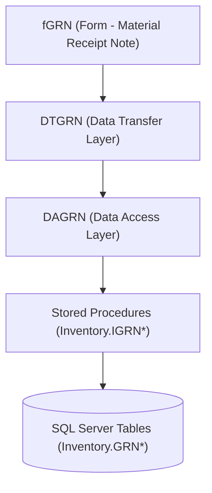

# Material Receipt Note (GRN) — API Documentation

This document provides complete API documentation for the **Goods Received Note (GRN)** form, technically identified as `fGRN (Form - Material Receipt Note)` in SpectrumERP.

---

## 1. Overview & Business Context

### What is GRN?
The Goods Received Note (GRN) records physical material received at a warehouse against an authorized upstream document (such as a Purchase Order, Gate Entry, Stock Transfer, or Dispatch Challan). It establishes legal and physical custody of inventory, verifies quantities (accepted, rejected, free-of-cost), and turns verified consignments into usable stock.

### Primary Users
- **Storekeeper**: Unpacks consignments, checks delivery documents against physical counts, enters accepted/rejected counts, and assigns bins/warehouses.
- **Quality Inspector**: Performs quality testing against inspection parameters when inspection is required.
- **Finance / Accounts Officer**: Authorizes GRN, posts excise/GST entries, and matches purchase invoices against received goods.

### Business Lifecycle & Document Flow
1. **Upstream Source**: Material arrives at the gate and enters via `Gate Entry (Form)` or directly against `Purchase Order (Form)`.
2. **Draft Receipt (Status 10 - Initial)**: Storekeeper enters details, links items, records Challan/Bill numbers, batch/heat/serial details, and saves the draft GRN.
3. **Quality Check (Inspection Intimation & Order)**: If `InspectionRequired` is enabled, items are routed through `Quality Inspection (Form)`.
4. **Release (Status 20 - Released)**: GRN is confirmed for review and approval.
5. **Authorization (Status 30 - Authorized)**: Approver authorizes the GRN via `Inventory.IGRNAuthorize (Stored Procedure)`. 
   - Usable stock increases in `Inventory.InvLotSummary (Table)` and `Inventory.InvLotDetail (Table)`.
   - Purchase order balances decrease in `Purchase.PODetail (Table)`.
   - Accounting voucher is generated via `Finance.VoucherSaveForTransaction (Stored Procedure)`.

---

## 2. System Architecture

SpectrumERP implements a 3-tier architecture for the GRN module:



- **UI Layer (`fGRN`)**: Desktop Windows Form capturing user interactions, grids, and event validations.
- **Business / DT Layer (`DTGRN`)**: Validates business objects, handles data transfer transformations, tax computations, and currency conversions.
- **Data Access Layer (`DAGRN`)**: Formats SQL parameters, opens database transactions, and calls stored procedures.
- **Database Layer**: T-SQL Stored Procedures executing atomic database operations with rollback protection.

---

## 3. Database API / Stored Procedures Reference

The backend API for GRN is implemented as a set of specialized SQL Server stored procedures:

### 3.1 Initial Values & Lookups

#### `Inventory.IGRNFillValues`
- **Purpose**: Loads initial dropdown lists and form configuration when opening a new or existing GRN.
- **Parameters**:
  | Parameter | Type | Mode | Description |
  | :--- | :--- | :--- | :--- |
  | `@CompanyNo` | `tinyint` | INPUT | Company identifier |
  | `@GRNNo` | `int` | INPUT | GRN ID (pass `0` or `null` for new entry) |
- **Result Sets**:
  1. `Source Document`: Valid source types (PO, Gate Entry, Stock Transfer, Sales Order).
  2. `Vendor Name`: Active authorized vendors from `masterdata.mVendorcard (Table)`.
  3. `Item Grid Default Schema`: Blank structure for UI grid initialization.

#### `Inventory.IGRNFillValuesDependent`
- **Purpose**: Returns context-filtered lookup data based on selected division, source document, and company.
- **Parameters**:
  | Parameter | Type | Mode | Description |
  | :--- | :--- | :--- | :--- |
  | `@DivisionNo` | `int` | INPUT | Operating division ID |
  | `@GRNNo` | `int` | INPUT | Current GRN ID |
  | `@GRNSourceNo` | `tinyint` | INPUT | Source document code (2=PO, 3=Stock Transfer, 4=Gate Entry, 5=Challan, 9=Sales Order) |
  | `@CompanyNo` | `tinyint` | INPUT | Company identifier |
- **Result Sets**:
  1. `Warehouses`: Filtered warehouse list from `masterdata.mWarehouseDivisionDetail (Table)`.
  2. `Vendors`: Filtered vendors matching the specific source type.

#### `Inventory.IGRNRefDocDetail`
- **Purpose**: Fetches open upstream reference documents (PO lines, Gate Entries, Transfer notes) pending receipt for a selected vendor and location.
- **Parameters**:
  | Parameter | Type | Mode | Description |
  | :--- | :--- | :--- | :--- |
  | `@GRNNo` | `int` | INPUT | Current GRN number |
  | `@RefDocGroupNo` | `varchar(5000)`| INPUT | Comma-delimited list of reference IDs |
  | `@GRNSourceNo` | `tinyint` | INPUT | Source document type code |
  | `@CompanyNo` | `tinyint` | INPUT | Company ID |
  | `@VendorLocationNo`| `int` | INPUT | Specific vendor location |
  | `@DivisionNo` | `int` | INPUT | Division ID |
  | `@DispatchChallanNo`| `int` | INPUT | Dispatch challan ID (if inter-unit) |
  | `@GRNTypeNo` | `tinyint` | INPUT | 1 = Standard, 2 = Subcontract |
  | `@WarehouseNo` | `smallint` | INPUT | Destination warehouse |
  | `@ConsigneeLocationNo`| `int` | INPUT | Consignee location |
  | `@ReceipientPartyNo`| `int` | INPUT | Receiving party ID |
- **Result Sets**:
  1. Reference header details (Document number, Challan, Transporter, LR number, eWay bill).
  2. Available line items, open order quantities, previous received quantities, and balance quantities.

---

### 3.2 Document Validation

#### `Inventory.IGRNValidate`
- **Purpose**: Executes integrity rules prior to saving or status update.
- **Parameters**:
  | Parameter | Type | Mode | Description |
  | :--- | :--- | :--- | :--- |
  | `@CompanyNo` | `tinyint` | INPUT | Company ID |
  | `@GRNNo` | `int` | INPUT | Current GRN ID (or `null` for new) |
  | `@DocumentStatusNo`| `tinyint` | INPUT | Target status (10=Initial, 20=Release, 30=Authorized) |
  | `@InspectionRequired`| `bit` | INPUT | `1` if QC inspection is required |
  | `@DivisionNo` | `int` | INPUT | Operating division ID |
  | `@IsExcisePosting` | `bit` | INPUT | Excise/tax posting flag |
  | `@YearNo` | `tinyint` | INPUT | Financial year ID |
  | `@DocumentNoyearly`| `varchar(30)` | INPUT | Auto-numbered document string |
  | `@FormCode` | `char(4)` | INPUT | Form code (typically `'IGRN'`) |
  | `@SRDetail` | `xml` | INPUT | XML representation of items |
- **Validations Checked**:
  - Rejects edits to already authorized GRNs (`AuthorizedBy is not null`).
  - Checks for duplicate document yearly sequence numbers.
  - Verifies that Quality Intimation/Inspection orders are cleared before authorization when `InspectionRequired = 1`.

---

### 3.3 Persistence & Transaction Execution

A full GRN save executes across a composite transaction calling the following stored procedures in sequence:

#### 1. `Inventory.IGRNSave` (Main Header)
- **Purpose**: Creates or updates the primary GRN header in `Inventory.GRNMain (Table)`.
- **Parameters**:
  | Parameter | Type | Mode | Description |
  | :--- | :--- | :--- | :--- |
  | `@CompanyNo` | `tinyint` | INPUT | Company ID |
  | `@YearNo` | `tinyint` | INPUT | Financial Year ID |
  | `@GRNNo` | `int` | **IN/OUT** | Primary Key. Generates new ID when `0` |
  | `@DivisionNo` | `int` | INPUT | Division ID |
  | `@DocumentSettingNo`| `smallint` | INPUT | Document series numbering setting |
  | `@DocumentNoYearly` | `varchar(30)` | INPUT | Formatted Document number |
  | `@DocumentDate` | `smalldatetime`| INPUT | Receipt date |
  | `@DocumentStatusNo` | `tinyint` | INPUT | 10=Initial, 20=Release, 30=Authorized |
  | `@GRNSourceNo` | `tinyint` | INPUT | Source type (2=PO, 4=GateEntry, etc.) |
  | `@VendorLocationNo` | `int` | INPUT | Vendor Location ID |
  | `@VendorBillNo` | `varchar(50)` | INPUT | Vendor invoice/bill number |
  | `@VendorBilLDate` | `smalldatetime`| INPUT | Vendor invoice/bill date |
  | `@ChallanNo` | `varchar(50)` | INPUT | Delivery challan number |
  | `@ChallanDate` | `smalldatetime`| INPUT | Delivery challan date |
  | `@DeptNo` | `int` | INPUT | Department ID |
  | `@ProjectNo` | `int` | INPUT | Project reference ID |
  | `@StatusNo` | `smallint` | INPUT | System status flag |
  | `@Remarks` | `varchar(1000)`| INPUT | Notes / remarks |
  | `@AuthorizedBy` | `smallint` | INPUT | User ID authorizing receipt |
  | `@LoginNo` | `smallint` | INPUT | User ID saving the transaction |
  | `@InspectionRequired`| `bit` | INPUT | Inspection required flag |
  | `@ExChallanNo` | `varchar(30)` | INPUT | Excise challan number |
  | `@ExChallanDate` | `smalldatetime`| INPUT | Excise challan date |
  | `@DriverName` | `varchar(50)` | INPUT | Transporter driver name |
  | `@VehicleNo` | `varchar(15)` | INPUT | Transport vehicle registration number |
  | `@FreightTypeNo` | `tinyint` | INPUT | Freight arrangement (e.g., TOPAY, FOR) |
  | `@TransporterNo` | `int` | INPUT | Transporter vendor ID |
  | `@DispatchChallanNo`| `int` | INPUT | Linked dispatch challan ID |
  | `@IsExcisePosting` | `bit` | INPUT | Tax posting flag |
  | `@ExcisePostingNo` | `int` | INPUT | Linked excise posting ID |
  | `@GRNTypeNo` | `tinyint` | INPUT | GRN Type (1=Standard, 2=Subcontract) |
  | `@WarehouseNo` | `smallint` | INPUT | Header destination warehouse ID |
  | `@ConsigneeLocationNo`| `int` | INPUT | Consignee location ID |
  | `@FormCode` | `char(4)` | INPUT | Default `'IGRN'` |
  | `@ReceipientPartyNo`| `smallint` | INPUT | Recipient party ID |
  | `@LRNo` | `varchar(30)` | INPUT | Lorry receipt (LR) number |
  | `@LRDate` | `smalldatetime`| INPUT | Lorry receipt date |
  | `@FromLocationNo` | `smallint` | INPUT | Dispatched from location ID |
  | `@ToLocationNo` | `smallint` | INPUT | Destination location ID |
  | `@LocationNo` | `smallint` | INPUT | Storage location ID |
  | `@GSTDNo` | `int` | INPUT | GST configuration identifier |
  | `@VoucherNo` | `int` | INPUT | Linked accounts voucher ID |
  | `@VehicleCapacity` | `decimal(12,3)`| INPUT | Vehicle capacity |
  | `@Distance` | `decimal(7,2)` | INPUT | Transit distance in km |
  | `@ExciseChallanNo` | `int` | INPUT | Internal excise challan ID |
  | `@IsReturnThroughDC`| `bit` | INPUT | Return rejected goods via dispatch challan |
  | `@CurrencyConversionNo`| `smallint`| INPUT | Currency ID |
  | `@DivisibilityRate`| `decimal(9,6)` | INPUT | Foreign exchange divisor |
  | `@MultiplicativeRate`| `decimal(9,6)`| INPUT | Foreign exchange multiplier |
  | `@eWayBillNo` | `varchar(50)` | INPUT | Government e-Way bill number |
  | `@eWayBillDate` | `smalldatetime`| INPUT | e-Way bill issue date |
  | `@IssueNo` | `int` | INPUT | Internal issue reference ID |
  | `@GatepassOutNo` | `int` | INPUT | Linked return gatepass out ID |
  | `@TATNo` | `int` | INPUT | Turnaround turnaround tracking ID |
  | `@IsPurchaseBillNotRequired`| `bit` | INPUT | Set to 1 if no purchase bill needed |
  | `@LastModifiedDate`| `datetime` | INPUT | Timestamp for concurrency validation |
  | `@OutputStatusNo` | `tinyint` | OUTPUT | Return status code |
  | `@OutputStatusRemarks`| `varchar(4000)`| OUTPUT | Return message |

#### 2. `Inventory.IGRNSaveRefDocDetail`
- **Purpose**: Records associations between the GRN and source reference documents in `Inventory.GRNRefDocDetail (Table)`.
- **Parameters**:
  - `@GRNNo` (`int`)
  - `@RefDocNo` (`int`): Reference document ID (e.g. PO Amendment ID, Gate Entry ID)
  - `@GRNSourceNo` (`tinyint`): Reference type (2=PO, 3=Transfer, 4=Gate Entry, etc.)

#### 3. `Inventory.IGRNSaveGRNItemDetail`
- **Purpose**: Persists individual material line items into `Inventory.GRNItemDetail (Table)`.
- **Parameters**:
  | Parameter | Type | Description |
  | :--- | :--- | :--- |
  | `@GRNNo` | `int` | Header GRN number |
  | `@POAmendmentNo` | `int` | Linked PO amendment ID |
  | `@GateEntryNo` | `int` | Linked gate entry ID |
  | `@ItemNo` | `int` | Item master ID |
  | `@MakeNo` | `smallint` | Brand / make ID |
  | `@UnitNo` | `smallint` | Transaction unit of measure ID |
  | `@TechicalSpecification`| `varchar(4000)`| Item technical details |
  | `@ChallanQty` | `decimal(12,3)`| Quantity stated on vendor challan |
  | `@ReceivedQty` | `decimal(12,3)`| Physical quantity counted at receiving |
  | `@RejectedQty` | `decimal(12,3)`| Rejected quantity (damaged/substandard) |
  | `@ReplaceableQty` | `decimal(12,3)`| Rejected quantity to be replaced by vendor |
  | `@AcceptedQty` | `decimal(12,3)`| Good quantity accepted into inventory |
  | `@FOCQty` | `decimal(12,3)`| Free-of-cost bonus quantity |
  | `@FOCRate` | `decimal(12,2)`| Valuation rate for FOC goods |
  | `@Rate` | `money` | Basic purchase rate |
  | `@FirstCF` | `decimal(7,3)` | Unit conversion factor 1 |
  | `@SecondCF` | `decimal(7,3)` | Unit conversion factor 2 |
  | `@StockQty` | `decimal(12,3)`| Equivalent quantity in base stocking unit |
  | `@Remarks` | `varchar(500)` | Line item remarks |
  | `@BINNo` | `smallint` | Assigned warehouse bin card ID |
  | `@WareHouseNo` | `smallint` | Destination warehouse ID |
  | `@TechnicalGradeNo`| `tinyint` | Material technical grade |
  | `@ExcessQty` | `decimal(12,3)`| Excess quantity beyond PO tolerance |
  | `@InvStockTransferNo`| `int` | Stock transfer document ID (if transfer) |
  | `@BOMRevisionSerialNo`| `int` | Subcontract BOM serial ID |
  | `@BOMRevisionNo` | `int` | Subcontract BOM revision ID |
  | `@DispatchChallanNo`| `int` | Dispatch challan ID |
  | `@SCOrderAmendmentNo`| `int` | Subcontract order ID |
  | `@RouteIdentity` | `decimal(10,8)`| Route identifier |
  | `@POItemNo` | `int` | Original PO item line ID |
  | `@POMakeNo` | `smallint` | Original PO make ID |
  | `@POTechnicalGradeNo`| `tinyint` | Original PO technical grade |
  | `@ChapterheadingNo`| `int` | HSN / Chapter heading code ID |
  | `@SalesOrderNo` | `int` | Linked customer sales order ID |
  | `@ExpiryDate` | `smalldatetime`| Product shelf life / expiry date |
  | `@BatchNo` | `varchar(50)` | Vendor manufacturer batch number |
  | `@SecondaryReceivedQty`| `decimal(12,3)`| Quantity in secondary unit |

#### 4. Additional Item-Level Detail Procedures
- `Inventory.IGRNSaveGRNItemIndentDetail`: Maps accepted and rejected quantities to specific department purchase indents in `Inventory.GRNItemIndentDetail (Table)`.
- `Inventory.IGRNSaveIndentReserveDetail`: Adjusts reserved indent quantities in `Inventory.GRNIndentReserveDetail (Table)`.
- `Inventory.IGRNSaveGRNItemLotDetail`: Records Heat / Melt numbers, external lot numbers, and cost centers into `Inventory.GRNItemLotAdditionalDetail (Table)`.
- `Inventory.IGRNSaveGRNItemSerialDetail`: Saves individual equipment / machine serial numbers into `Inventory.GRNItemSerialDetail (Table)`.
- `Inventory.IGRNSaveItemAttribute`: Records custom item attributes (e.g. dimensions, chemical specs) into `Inventory.GRNItemAttributeIskcon (Table)`.
- `Inventory.IGRNSaveItemTaxDetail`: Saves item-level GST / tax split into `Inventory.GRNItemTaxDetail (Table)`.

#### 5. Header-Level Detail Procedures
- `Inventory.IGRNSaveTaxDetail`: Saves overall document charges (freight, insurance, GST) into `Inventory.GRNTaxDetail (Table)`.
- `Inventory.IGRNSaveNotesDetail`: Records print area terms, conditions, and annotations into `Inventory.GRNNotesDetail (Table)`.

---

### 3.4 Authorization & Stock Posting

#### `Inventory.IGRNAuthorize`
- **Purpose**: Authorizes a verified GRN.
- **Actions Performed**:
  1. Validates that all items pass quality inspection if inspection is enabled.
  2. Updates `Inventory.InvLotSummary (Table)` and `Inventory.InvLotDetail (Table)` to increase physical stock balance.
  3. Closes or reduces pending balances in `Purchase.POItemDetail (Table)` and `GateEntry.InvGateEntryItemDetail (Table)`.
  4. Triggers multi-level approval notifications in `Notifications.TATAuthorizationDetail (Table)`.
  5. Determines whether purchase bill booking is required (`IsPurchaseBillNotRequired`).

---

### 3.5 Read, Search & Deletion

#### `Inventory.IGRNLoadData`
- **Purpose**: Retrieves all 14 datasets comprising a complete GRN document.
- **Parameters**:
  - `@GRNNo` (`int`): Primary key of the GRN.
- **Result Sets Returned**:
  1. **Header**: `GRNMain` fields, currency rate, multi-level authorization flag, and vendor details.
  2. **Item Details**: Line items, quantities (challan, received, accepted, rejected, replaceable, stock), rates, bin, and warehouse.
  3. **Serial Numbers**: Item serial numbers and expiry dates.
  4. **Notes**: Terms and print notes.
  5. **Reference Documents**: Associated Gate Entries, POs, or Challans.
  6. **Intimation Status**: Quality inspection intimation flags.
  7. **Inspection Status**: Quality inspection result authorization flags.
  8. **Excise Main**: Excise and GST posting header.
  9. **Excise Item Tax**: Tax breakdowns per line.
  10. **Excise Summary**: Consolidated taxes by category.
  11. **GRN Tax Summary**: Consolidated document charges and account mapping rules.
  12. **Item Tax Detail**: Specific item tax splits.
  13. **Attributes**: Custom item attribute specifications.
  14. **Lot Details**: External heat numbers, internal heat numbers, and cost centers.

#### `Inventory.IGRNSearchData`
- **Purpose**: Searches and filters GRN records for open/search lookups.
- **Parameters**:
  - `@CompanyNo` (`tinyint`)
  - `@YearNo` (`tinyint`)
  - `@FormCode` (`char(4)`): `'IGRN'`
  - `@LoginNo` (`smallint`)

#### `Inventory.IGRNDelete`
- **Purpose**: Cancels/deletes an un-authorized GRN document.
- **Actions**:
  - Restores in-transit quantities on linked stock transfers.
  - Deletes unauthorized allocation entries.
  - Cleans up provision records in `Finance.ProvisionGRNDetail (Table)`.
  - Removes associated line items, serials, and tax rows.

---

## 4. Modern REST API Interface Specification

When exposing the GRN functionality via modern RESTful microservices, the endpoints map directly to the underlying stored procedures:

### Base URL: `/api/v1/inventory/grn`

### Endpoints Overview

| Method | Endpoint | Description | Underlying Stored Procedure |
| :--- | :--- | :--- | :--- |
| `GET` | `/initial-values` | Fetch initial form lookups | `Inventory.IGRNFillValues` |
| `GET` | `/dependent-lookups` | Fetch division/source filtered lookups | `Inventory.IGRNFillValuesDependent` |
| `GET` | `/reference-documents`| Load open POs / Gate Entries | `Inventory.IGRNRefDocDetail` |
| `POST`| `/validate` | Run pre-save integrity checks | `Inventory.IGRNValidate` |
| `POST`| `/` | Create a new GRN document | `Inventory.IGRNSave` (Composite) |
| `PUT` | `/{grnNo}` | Update an existing un-authorized GRN | `Inventory.IGRNSave` (Composite) |
| `GET` | `/{grnNo}` | Fetch complete GRN document | `Inventory.IGRNLoadData` |
| `GET` | `/` | Search / filter GRN list | `Inventory.IGRNSearchData` |
| `POST`| `/{grnNo}/authorize`| Authorize GRN and post to stock | `Inventory.IGRNAuthorize` |
| `DELETE`| `/{grnNo}` | Cancel or delete un-authorized GRN | `Inventory.IGRNDelete` |
| `GET` | `/{grnNo}/qc-info` | Get QC inspection history & specs | `Inventory.IGRNItemQCInfo` |

---

### Endpoint Schemas & Payloads

#### 1. Create / Update GRN (`POST /api/v1/inventory/grn`)

**Request Payload (`application/json`):**
```json
{
  "companyNo": 1,
  "yearNo": 24,
  "divisionNo": 2,
  "documentDate": "2026-11-13T10:00:00Z",
  "documentStatusNo": 10,
  "grnSourceNo": 4,
  "vendorLocationNo": 403,
  "vendorBillNo": "INV-2026-9921",
  "vendorBillDate": "2026-11-12T00:00:00Z",
  "challanNo": "CH-88219",
  "challanDate": "2026-11-12T00:00:00Z",
  "departmentNo": 5,
  "inspectionRequired": true,
  "warehouseNo": 1,
  "driverName": "Ramesh Kumar",
  "vehicleNo": "MH12AB1234",
  "transporterNo": 12,
  "freightTypeNo": 2,
  "lrNo": "LR-99201",
  "lrDate": "2026-11-12T00:00:00Z",
  "eWayBillNo": "231099281726",
  "eWayBillDate": "2026-11-12T00:00:00Z",
  "remarks": "Received in good packing condition.",
  "referenceDocuments": [
    {
      "refDocNo": 1045,
      "grnSourceNo": 4
    }
  ],
  "items": [
    {
      "itemNo": 10012,
      "makeNo": 1,
      "unitNo": 3,
      "technicalSpecification": "Standard Steel Bars 12mm",
      "challanQty": 500.000,
      "receivedQty": 500.000,
      "acceptedQty": 490.000,
      "rejectedQty": 10.000,
      "replaceableQty": 10.000,
      "focQty": 0.000,
      "rate": 62.50,
      "warehouseNo": 1,
      "binNo": 14,
      "batchNo": "B-2026-NOV-01",
      "expiryDate": "2027-11-30T00:00:00Z",
      "remarks": "10 pcs bent at edge",
      "lotDetails": [
        {
          "heatNoExternal": "HT-9921A",
          "heatNoInternal": "INT-0012",
          "acceptedQty": 490.000,
          "rejectedQty": 10.000,
          "costCenterNo": 101
        }
      ],
      "serialNumbers": [],
      "indents": [
        {
          "indentNo": 2041,
          "acceptedQty": 490.000,
          "rejectedQty": 10.000
        }
      ]
    }
  ],
  "taxes": [
    {
      "miscChargeNo": 1,
      "chargeType": 1,
      "nature": 1,
      "chargeOn": 1,
      "chargeValue": 18.000,
      "totalValue": 5512.50,
      "taxCodeMiscChargesDetailNo": 5,
      "includeInBasic": false
    }
  ],
  "notes": [
    {
      "printAreaNo": 1,
      "notes": "Goods verified as per sample specification.",
      "isDefault": true
    }
  ]
}
```

**Success Response (`201 Created`):**
```json
{
  "success": true,
  "grnNo": 12840,
  "documentNoYearly": "GRN/24-25/00142",
  "documentStatusNo": 10,
  "message": "Document No. GRN/24-25/00142 saved successfully."
}
```

---

#### 2. Authorize GRN (`POST /api/v1/inventory/grn/{grnNo}/authorize`)

**Request Payload:**
```json
{
  "authorizedBy": 25,
  "remarks": "Quality verified and accepted into stock."
}
```

**Success Response (`200 OK`):**
```json
{
  "success": true,
  "grnNo": 12840,
  "documentStatusNo": 30,
  "stockUpdated": true,
  "voucherNo": 49201,
  "message": "GRN 12840 successfully authorized and posted to inventory."
}
```

---

## 5. Critical Business Rules & Validations

| Validation Rule | Enforcement Layer | Error / Action |
| :--- | :--- | :--- |
| **Immutability of Authorized GRN** | `Inventory.IGRNSave`, `Inventory.IGRNValidate` | Cannot modify or delete a GRN once `AuthorizedBy` is recorded (`Authorized GRN can't be updated`). |
| **Quantity Conservation** | UI (`fGRN`) & `Inventory.IGRNSaveGRNItemDetail` | `Received Qty` must strictly equal `Accepted Qty + Rejected Qty + FOC Qty`. |
| **Tolerance Limits** | `Inventory.IGRNValidate` | Accepted quantity cannot exceed PO balance + allowed company tolerance percentage. |
| **Inspection Gating** | `Inventory.IGRNAuthorize`, `Quality.InspectionResultMain` | If `InspectionRequired = true`, authorization is blocked until inspection results are submitted and approved. |
| **Date Hierarchy** | `Inventory.IGRNValidate` | Vendor Bill Date, Challan Date, and e-Way Bill Date cannot be greater than the GRN Document Date. |
| **Duplicate Checking** | `Inventory.IGRNValidate` | Rejects duplicate document numbers within the same company and financial year. |
| **Stock Month Lock** | `Inventory.IGRNSave` | Transactions blocked if month is closed via Stock Monthly Closing (`ISML`). |
| **Batch & Expiry Mandate** | `masterdata.mItemOtherInformation` | For items marked `IsMaintainBatch` or `IsMaintainExpiryDate`, batch and expiry fields are compulsory. |

---

## 6. Persisted Database Tables

The GRN transaction writes to and updates the following tables:

| Table Name | Description | Key Columns |
| :--- | :--- | :--- |
| `Inventory.GRNMain` | Primary transaction header | `GRNNo`, `DocumentNoYearly`, `DocumentDate`, `VendorLocationNo`, `DocumentStatusNo`, `AuthorizedBy` |
| `Inventory.GRNItemDetail` | Line items and quantities | `GRNItemDetailNo`, `GRNNo`, `ItemNo`, `AcceptedQty`, `RejectedQty`, `ChallanQty`, `ReceivedQty`, `Rate` |
| `Inventory.GRNRefDocDetail` | Associated reference documents | `GRNNo`, `GateEntryNo`, `POAmendmentNo`, `InvStockTransferNo`, `DispatchChallanNo` |
| `Inventory.GRNItemIndentDetail` | Indent quantity allocation | `GRNIndentDetailNo`, `GRNItemDetailNo`, `IndentNo`, `AcceptedQty`, `RejectedQty` |
| `Inventory.GRNIndentReserveDetail` | Indent stock reservation | `GRNItemDetailNo`, `IndentItemReserveNo`, `ReserveQty` |
| `Inventory.GRNItemLotAdditionalDetail`| Heat numbers, lots, cost centers | `GRNItemLotDetailNo`, `GRNItemDetailNo`, `HeatNoExternal`, `HeatNoInternal`, `AcceptedQty` |
| `Inventory.GRNItemSerialDetail` | Serial tracking per piece | `GRNItemSerialDetailNo`, `GRNItemDetailNo`, `SerialNo`, `ExpiryDate` |
| `Inventory.GRNItemAttributeIskcon` | Attribute breakdowns | `GRNItemDetailNo`, `ItemAttributeNo`, `Qty`, `Rate` |
| `Inventory.GRNItemTaxDetail` | Item-level tax lines | `GRNItemDetailNo`, `MiscChargeNo`, `ChargeValue`, `TotalAmount` |
| `Inventory.GRNTaxDetail` | Header-level tax & charges | `GRNNo`, `MiscChargeNo`, `ChargeValue`, `TotalValue`, `TaxCodeMiscChargesDetailNo` |
| `Inventory.GRNNotesDetail` | Print area annotations | `GRNNo`, `PrintAreaNo`, `Notes`, `IsDefault` |
| `Inventory.InvLotDetail` | Physical stock lots (upon authorize)| `LotNo`, `ItemNo`, `WarehouseNo`, `BinNo`, `AcceptedQty`, `BalanceQty` |
| `Inventory.InvLotSummary` | Stock summaries (upon authorize) | `ItemNo`, `WarehouseNo`, `BalanceQty` |
